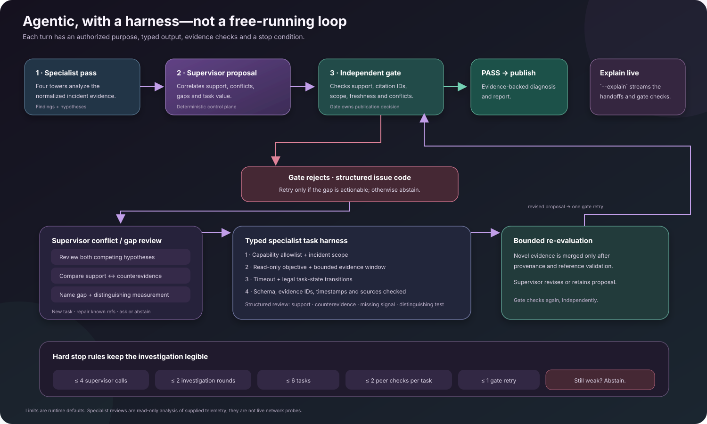

<div align="center">

# NetCoop

### Network troubleshooting with specialist towers, bounded teamwork, and evidence you can audit.

NetCoop turns the telemetry you already have into a grounded investigation: what the data suggests, which devices may be involved, what supports that conclusion, and what is still unknown.

<p>
  
  
  
  
  
</p>

[CLI setup](docs/CLI.md) · [Dashboard setup](docs/DASHBOARD.md) · [Input formats](docs/INPUT_FORMATS.md) · [Network profiles](docs/NETWORK_PROFILES.md)

</div>

> **Bring a capture, not a collector.** NetCoop analyzes telemetry files you provide; it does not log in to network devices or collect live data.

## The architecture is the product

NetCoop is built around **four domain-specific towers**. Each tower runs deterministic checks for one part of the network, grounded in the same normalized evidence. They communicate through a typed integration fabric. A supervisor harness selects bounded follow-up work and manages the investigation; an independent evidence gate decides whether the proposed diagnosis is supported well enough to publish.

That is the advantage over a roomful of general-purpose agents: specialist coverage does not require a separate LLM to reinterpret the same raw capture four times. Deterministic towers do the broad diagnostic pass. Efficient model assistance is reserved for constrained work after the deterministic supervisor has a supported candidate. It can refine safe next steps, but cannot take over the diagnosis.

<p align="center">
  
</p>

### What the towers check

| Tower | Deterministic checks include |
| --- | --- |
| **Performance** | Interface utilization and headroom; queue drops and packet loss; retransmissions and jitter; Wi-Fi RSSI/SNR. |
| **Infrastructure** | CPU and memory thresholds; interface state and flaps; CRC and physical errors; supported error-log bursts. |
| **Connectivity** | Graph reachability; declared DNS/DHCP path traces; partitions only with complete topology; up to three-hop impact candidates. |
| **Services** | DNS latency and response failures; DHCP pool exhaustion and NAK signals; configuration drift in sensitive settings. |

These are focused analyzers, not four LLM personas. They publish typed findings and hypotheses with observation references. The integration fabric carries events, read-only peer queries, and supervisor-delegated tasks; for example, a DNS finding can prompt a connectivity path check. Requests, responses, limitations, and evidence references remain inspectable.

## An agent harness with boundaries

NetCoop's agentic behavior lives in the runtime around the towers—not just in prompts. The deterministic supervisor owns incident state, task authorization, conflict handling, evidence merging, and publication. It can ask specialists for more discriminating analysis, but each task passes through a harness:

1. **Choose a useful next step.** The supervisor considers competing hypotheses, evidence gaps, task value, and cost. For a conflict, the review reports supporting evidence, counterevidence, missing measurements, and a test that could distinguish the hypotheses.
2. **Authorize a narrow task.** Capability registries constrain who can do what. Tasks carry an incident scope, objective, constraints, expected result schema, and deadline; the agents do not get arbitrary tools or write access to devices.
3. **Validate the response.** The harness enforces legal task-state transitions, checks the typed artifact schema, and verifies finding IDs plus observation IDs, values, timestamps, entities, and sources against the actual capture. Invalid or out-of-scope artifacts do not enter the supervisor's evidence set.
4. **Check for useful novelty.** A task cannot simply be repeated without new evidence. Unavailable signals are recorded as unavailable, rather than being invented or silently treated as a failed measurement.
5. **Let the gate decide.** The gate returns structured issue codes. A retryable evidence gap can trigger a targeted task; a reference/schema problem can be corrected from known evidence. The independent gate checks again after at most one retry. If support is still weak, NetCoop abstains.

<p align="center">
  
</p>

### Conflict resolution and vague captures

When towers disagree, the supervisor classifies the conflict—such as competing causes or different interpretations of the same evidence. It does not settle the issue by majority vote or by picking the most confident-sounding agent. Instead, it asks for structured reviews of the competing hypotheses: **what supports each one, what contradicts it, what measurement is missing, and what test would separate them**. The supervisor ranks candidate follow-ups with a value-versus-cost heuristic and requests a specific read-only specialist task when it can help.

That same discipline helps on vague or sparse cases. A broad symptom does not make the towers guess a cause. If the needed signal is absent, the result records it as unavailable and can surface a targeted question for the operator. If there is no evidence-based way to separate the possibilities, NetCoop abstains. The `--symptom-chat` comparison runs after the gate and cannot steer the diagnosis.

The default runtime caps an investigation at **4 supervisor calls, 2 investigation rounds, 6 tasks, 2 peer checks per task, and 1 gate retry**. These are hard orchestration budgets, not suggestions to keep chatting until an answer appears. Specialist work is read-only analysis of supplied telemetry; NetCoop does not execute live probes or network changes.

### Efficient model assistance

The deterministic supervisor first checks whether a diagnosis is supportable. Only a qualifying proposal can reach the OpenRouter model path. The model receives a structured incident dossier and may return up to five bounded, read-only recommendations. The runtime checks those actions against known entities and evidence; it preserves the deterministic diagnosis, confidence, affected entities, and citations. An evidence request or abstention stays in control.

This design reduces unnecessary model traffic by keeping routine specialist analysis local and narrowing model work to a constrained point in the flow. **We have not published a measured token-savings benchmark**; actual usage depends on capture size, model choice, and enabled features. The benefit we can show in code is architectural: no model call per tower, bounded orchestration, and restricted model authority.

## From capture to a result you can inspect

1. **Normalize.** Read JSON, JSON Lines, or CSV telemetry plus a topology map when available. Report malformed rows, missing timestamps, unknown metrics, and incompatible units rather than making up values.
2. **Analyze.** Four specialist towers produce domain findings and share scoped peer checks through the integration fabric.
3. **Coordinate.** The supervisor compares findings and conflicts, chooses targeted tasks when they can change the answer, and tracks task outcomes and limitations.
4. **Verify.** The evidence gate checks citation existence, provenance, incident scope, conflicts, data-quality warnings, and orchestration history.
5. **Publish carefully.** The report contains the diagnosis or abstention, evidence, confidence, recommendations, and separate observed entities versus topology-inferred impact candidates.

Run `netcoop triage ./capture --explain` to stream the investigation as it happens: specialist findings, inter-agent handoffs, task choices, evidence provenance, and gate checks. Explanation output shows concise rationale summaries, not private model chain-of-thought. The report stays on stdout while the live trace goes to stderr, so JSON remains script-friendly.

## A network profile, not a vendor lock-in

Versioned YAML profiles map supported source fields, entity aliases, metric names and units, counter semantics, service roles, topology relationships, anchors, topology completeness, and known rule thresholds into NetCoop's canonical format. That lets an operator adapt many flat telemetry exports without changing tower code.

Profiles are deliberately honest about their boundary: they cannot infer unknown metric meaning, make a new signal diagnosable without analyzer support, or decode arbitrary deeply nested collector payloads. Use [Network profiles](docs/NETWORK_PROFILES.md) to draft and validate a site profile and [input formats](docs/INPUT_FORMATS.md) to prepare captures and topology maps.

## What you can do with it

| Workflow | What you get |
| --- | --- |
| **CLI triage** | Local capture analysis, `--explain` live orchestration trace, JSON/Markdown exports, profile tools, and automation. See [CLI setup](docs/CLI.md). |
| **Dashboard** | Scenario picker, explicit telemetry/map upload, live run activity, interactive topology graph, sessions, and assistant chat. See [Dashboard setup](docs/DASHBOARD.md). |
| **Follow-up session** | Several runs and a conversation kept together. Chat can explain reports and compare runs; adding telemetry always requires an explicit new analysis. |
| **Symptom comparison** | `--symptom-chat` compares a caller's wording with the published diagnosis after the gate. It never steers the diagnostic decision. |

## Read results with the right confidence

- **Observed impact** means an entity is supported by cited capture evidence.
- **Inferred impact** means topology suggests a possible downstream entity; it is a prediction, not confirmed user impact.
- A missing path supports a partition only when the map is declared complete.
- A missing measurement is a limitation, not evidence that the system measured a healthy value.
- Bundled scenarios are synthetic regression checks, not a real-world accuracy estimate. See the [benchmark notes](docs/CLI.md#try-the-included-cases).

## A strong synthetic benchmark signal

The latest local run on **2026-11-01** of [`scripts/evaluate_generator.py`](scripts/evaluate_generator.py) scored well across our seeded synthetic suite:

<p align="center">
  
  
  
</p>

| Measure | Result |
| --- | ---: |
| Expected scenario outcome: exact fault class, or abstention for healthy baseline | **21/21 (100%)** |
| Injected-fault cases containing the expected target entity | **18/18 (100%)** |
| Healthy baseline cases correctly abstained on | **3/3 (100%)** |
| Reported affected-entity set vs. generator's intended-impact labels | **83.3% precision · 100% recall · 90.9% F1** |
| Exact affected-entity set match | **15/21 (71.4%)** |

Those cases come from **our in-repo seeded network simulator** in [`reference/sample_generator.py`](reference/sample_generator.py): it generates time-series baseline traffic, injects a timed fault into a 10-node campus graph, and writes telemetry, topology, and evaluation ground truth as separate artifacts. This benchmark uses seven presets (one healthy baseline and six fault classes), three seeds (`7`, `42`, `2026`), and 15 time steps sampled 30 seconds apart. The evaluator reads the labels only after each diagnosis. Reproduce the run with:

```bash
uv run python scripts/evaluate_generator.py
```

We also keep five diagnostic-only edge captures for compound DNS/DHCP and DNS/congestion faults, high-utilization red herrings, malformed telemetry, and invalid topology. Those are not included in the score above.

**Scope matters:** this is a useful regression result against our simulator, not a claim of 100% accuracy on live networks. The simulator uses one fixed campus topology and a small, known set of injected faults. The impact scores compare against intended synthetic labels, not independently observed user impact. We show the imperfect impact-set exact match alongside the strong classification score because they measure different things.

## Get started

Requirements: Python 3.12 or newer. The dashboard also needs Node.js 18 or newer and npm. Deterministic analysis runs locally without an API key. Efficient model assistance, symptom comparison, and session chat use OpenRouter.

Keep setup straightforward: [CLI instructions](docs/CLI.md) and [server/dashboard instructions](docs/DASHBOARD.md) are separate so you can follow only the workflow you need.

## Local data and privacy

Run records, reports, sessions, and assistant turns are stored under the local, Git-ignored `data/netcoop/` directory. Deterministic analysis makes no model API calls. When model assistance is used, the context needed for that feature is sent to the configured provider; follow your organization's data policy.
