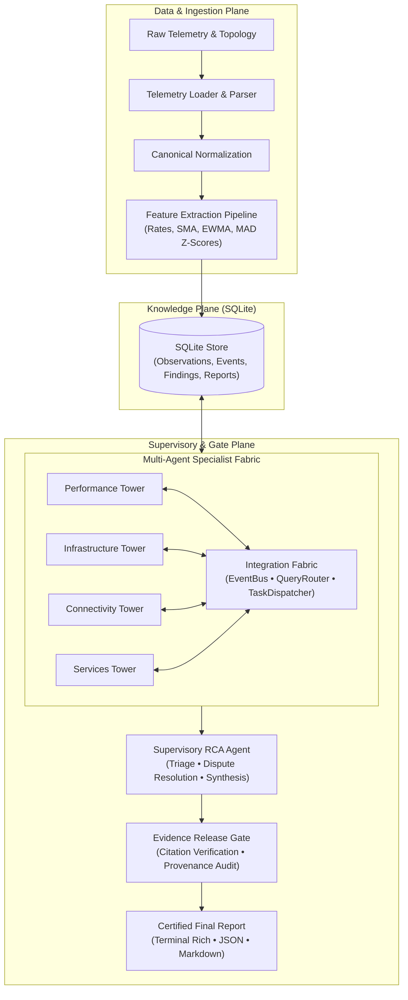

# NetCoop AI: Autonomous Multi-Agent Network Root Cause Analysis

[](https://www.python.org/downloads/)
[](LICENSE)
[]()
[](https://github.com/astral-sh/ruff)

**NetCoop AI** is an autonomous multi-agent cooperative network diagnostic platform engineered to triage, correlate, and determine root causes for campus and enterprise network incidents.

Unlike monolithic LLM chatbots, NetCoop AI uses a modular **specialist-tower architecture** coordinated by an asynchronous integration fabric, governed by a Supervisory RCA Agent, and rigorously certified by an anti-hallucination **Evidence Release Gate**.

---

## Key Features

- **Four Domain Specialist Towers**:
  - **Performance Tower**: Analyzes interface utilization, buffer queue drops, packet loss, TCP retransmissions, jitter, and Wi-Fi signal attenuation (RSSI/SNR).
  - **Infrastructure Tower**: Monitors hardware health, CPU/memory saturation, interface state flaps, and system log error bursts.
  - **Connectivity Tower**: Constructs dynamic network graph topologies, computes blast radiuses, isolates partitions, and identifies common upstream chokepoints.
  - **Services Tower**: Validates critical application protocol health (DNS resolution latencies, DHCP pool exhaustion, NTP synchronization, and configuration drift).
- **Asynchronous Integration Fabric**:
  - Event Bus with deterministic priority ordering and idempotent event delivery.
  - Query Router enforcing bounded peer queries between towers.
  - Task Dispatcher with strict supervisor-only delegation and counter-proposal lifecycle.
- **Evidence Release Gate**:
  - Independent verification barrier that checks every claim and citation against ground-truth canonical observation IDs before any diagnosis is released.
  - Completely eliminates LLM hallucinations and unverified root causes.
- **100% Offline Determinism with Optional LLM Mode**:
  - Runs out of the box with zero external dependencies, zero API keys, and zero network calls.
  - Optional `--llm auto` and `--llm on` support to enrich reports using Gemini / LLM providers when configured.
- **Rich CLI & Reporting Experience**:
  - Terminal-native Rich UI with status tables, progress indicators, and visual diagnostic synthesis.
  - Machine-readable JSON export conforming to `FinalReport` schema and human-readable Markdown incident briefs.

---

## Architecture Overview



---

## Installation & Setup

NetCoop AI is built with modern Python packaging via `uv`.

### Prerequisites
- Python 3.11+
- [uv](https://github.com/astral-sh/uv) (recommended) or standard `pip`

### Quick Setup

```bash
# Clone the repository
git clone https://github.com/your-org/netcoop-ai.git
cd netcoop-ai

# Create virtual environment and install dependencies
uv sync

# Verify installation with system doctor
uv run netcoop doctor
```

---

## CLI Usage Guide

NetCoop AI exposes a comprehensive command-line interface:

### 1. System Health Check (`doctor`)
Verifies Python version, vocabulary configurations, capability registries, SQLite engine, towers, and the Evidence Gate.
```bash
uv run netcoop doctor
```

### 2. Available Benchmark Scenarios (`scenarios`)
Lists and inspects the packaged benchmark incident scenarios.
```bash
uv run netcoop scenarios

# Or regenerate the synthetic scenario catalog:
uv run netcoop scenarios --generate
```

### 3. Run Automated Multi-Scenario Demo (`demo`)
Executes an autonomous offline demonstration across the 5 core benchmark scenarios (Healthy, Link Congestion, Weak Wi-Fi, Device Overload, DNS Failure).
```bash
uv run netcoop demo
```

### 4. End-to-End Incident Diagnosis (`diagnose`)
Diagnoses any scenario folder or raw telemetry file.
```bash
# Interactive Rich terminal output
uv run netcoop diagnose fixtures/scenarios/link_congestion

# Export formatted Markdown report
uv run netcoop diagnose fixtures/scenarios/weak_wifi --format markdown -o report.md

# Export machine-readable JSON for automated response
uv run netcoop diagnose fixtures/scenarios/device_overload --format json -o report.json

# Persist findings and events to SQLite database
uv run netcoop diagnose fixtures/scenarios/dns_failure --db incident.db
```

### 5. Inspect Persisted Incidents (`inspect`)
Queries the SQLite Knowledge Plane to audit tower findings, event bus histories, and certified final reports for an incident.
```bash
uv run netcoop inspect --db incident.db --incident-id INC-SYNTH-DNS-001
```

### 6. Telemetry Ingestion & Validation (`validate` & `ingest`)
```bash
# Validate schema of raw observation records
uv run netcoop validate fixtures/scenarios/link_congestion/telemetry.jsonl

# Ingest and extract derived features into SQLite
uv run netcoop ingest fixtures/scenarios/link_congestion/telemetry.jsonl --incident-id INC-001 --db test.db
```

---

## Benchmark Scenarios

The repository includes pre-built synthetic network incident scenarios in `fixtures/scenarios/`:

| Scenario | Category | Fault Injected | Expected Diagnosis |
|---|---|---|---|
| `healthy` | Baseline | None | Clean ABSTAIN (zero false alarms) |
| `link_congestion` | Performance | Core Uplink Saturation (`Gi0/1`) | `LINK_CONGESTION` |
| `weak_wifi` | Wireless | Hostel AP Signal Attenuation | `WEAK_WIFI` |
| `interface_fault` | Infrastructure | Interface Errors & CRC Drops | `INTERFACE_FAULT` |
| `device_overload` | Hardware | Core Switch CPU Exhaustion | `DEVICE_OVERLOAD` |
| `dns_failure` | Services | DNS Daemon Latency & SERVFAIL | `DNS_FAILURE` |
| `dhcp_failure` | Services | DHCP Pool Exhaustion & NAKs | `DHCP_FAILURE` |

---

## Testing & Quality Assurance

NetCoop AI maintains a rigorous test suite covering contracts, ingestion, feature engineering, SQLite persistence, inter-agent fabric, specialist towers, supervisory reasoning, evidence gate, and CLI operations:

```bash
# Run all 132 unit tests
uv run pytest -v

# Run code style and linter checks
uv run ruff check .
```

---

## Documentation Links

- [3-5 Minute Demo Script](docs/DEMO_SCRIPT.md)
- [System Architecture](docs/ARCHITECTURE.md)
- [Implementation Playbook](docs/IMPLEMENTATION_PLAYBOOK.md)
- [Inter-Agent Communication Specification](docs/INTERAGENT_COMMS.md)
- [Team Phase Plan](docs/TEAM_PHASE_PLAN.md)
- [Collaboration Log](docs/COLLAB_LOG.md)

---

## License

This project is licensed under the MIT License - see the `LICENSE` file for details.
