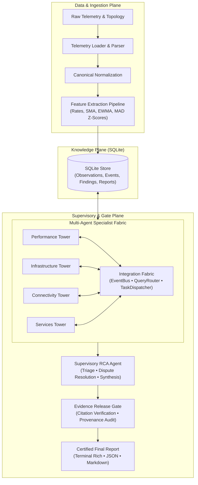

# NetCoop AI: Autonomous Multi-Agent Network Root Cause Analysis

[](https://www.python.org/downloads/)
[](LICENSE)
[]()
[](https://github.com/astral-sh/ruff)

**NetCoop AI** is an autonomous multi-agent cooperative network diagnostic platform engineered to triage, correlate, and determine root causes for campus and enterprise network incidents.

Unlike a monolithic diagnostic engine, NetCoop AI uses four specialist towers coordinated by a supervisor through a typed in-process integration fabric. The evidence gate verifies cited findings and observations before publishing a report.

---

## Key Features

- **Four Domain Specialist Towers**:
  - **Performance Tower**: Analyzes interface utilization, buffer queue drops, packet loss, TCP retransmissions, jitter, and Wi-Fi signal attenuation (RSSI/SNR).
  - **Infrastructure Tower**: Monitors hardware health, CPU/memory saturation, interface state flaps, and system log error bursts.
  - **Connectivity Tower**: Constructs dynamic network graph topologies, computes blast radiuses, isolates partitions, and identifies common upstream chokepoints.
  - **Services Tower**: Validates critical application protocol health (DNS resolution latencies, DHCP pool exhaustion, NTP synchronization, and configuration drift).
- **Integration Fabric**:
  - In-process Event Bus for findings notifications.
  - Typed, one-hop Query Router for read-only peer checks. Services asks Connectivity to trace declared DNS and DHCP paths; request, result, status, and topology evidence appear in the final report.
  - Task Dispatcher with supervisor-only delegation, scoped versioned artifacts, counter-proposal lifecycle, and budgeted follow-up.
- **Supervised orchestration**: The runtime owns incident state, task authorization, query routing policy, budgets, evidence merging, conflict handling, and publication. Tower findings remain independently auditable.
- **Evidence Release Gate**:
  - Independent verification barrier that checks cited findings, observation provenance, incident scope, data quality warnings, and orchestration history before a diagnosis is released.
- **Input resilience**: JSON, JSONL, and narrow or wide CSV ingestion; malformed records are quarantined, missing timestamps are not invented, and unknown metrics or incompatible units are surfaced as data quality issues.
- **Network profiles**: Versioned YAML profiles map source field names, entity aliases, metric names and units, counter semantics, service roles, topology relationships, anchors, completeness, and supported rule thresholds without changing tower code.
- **Evidence-aware diagnosis**: Concurrent causes remain visible, sparse temporal signals are called out, and missing paths in partial or unknown topologies do not become outage proof.
- **100% Offline Determinism with Optional LLM Mode**:
  - Deterministic diagnosis runs offline without API keys or network calls.
  - Optional `--llm auto` and `--llm on` modes can enrich reports when a supported provider is configured.
- **Rich CLI & Reporting Experience**:
  - Terminal-native Rich UI with status tables, progress indicators, and visual diagnostic synthesis.
  - Machine-readable JSON export conforming to `FinalReport` schema and human-readable Markdown incident briefs.

---

## Architecture Overview



---

## Installation & Setup

NetCoop AI is built with modern Python packaging via `uv`.

### Prerequisites
- Python 3.11+
- [uv](https://github.com/astral-sh/uv) (recommended) or standard `pip`

### Quick Setup

```bash
# Clone the repository
git clone https://github.com/your-org/netcoop-ai.git
cd netcoop-ai

# Create virtual environment and install dependencies
uv sync

# Verify installation with system doctor
uv run netcoop doctor
```

---

## CLI Usage Guide

NetCoop AI exposes a comprehensive command-line interface:

### 1. System Health Check (`doctor`)
Verifies Python version, vocabulary configurations, capability registries, SQLite engine, towers, and the Evidence Gate.
```bash
uv run netcoop doctor
```

### 2. Available Benchmark Scenarios (`scenarios`)
Lists and inspects the packaged benchmark incident scenarios.
```bash
uv run netcoop scenarios

# Or regenerate the synthetic scenario catalog:
uv run netcoop scenarios --generate
```

### 3. Run Automated Multi-Scenario Demo (`demo`)
Executes an autonomous offline demonstration across the 5 core benchmark scenarios (Healthy, Link Congestion, Weak Wi-Fi, Device Overload, DNS Failure).
```bash
uv run netcoop demo
```

### 4. End-to-End Incident Diagnosis (`diagnose`)
Diagnoses any scenario folder or raw telemetry file.
```bash
# Interactive Rich terminal output
uv run netcoop diagnose fixtures/scenarios/link_congestion

# Export formatted Markdown report
uv run netcoop diagnose fixtures/scenarios/weak_wifi --format markdown -o report.md

# Export machine-readable JSON for automated response
uv run netcoop diagnose fixtures/scenarios/device_overload --format json -o report.json

# Use and validate a deployment-specific network profile
uv run netcoop profile-init path/to/sample-data --name "Branch office" --output config/profiles/branch-office.yaml
# For unfamiliar flat records, provide source field mappings (repeat as needed)
uv run netcoop profile-init vendor.jsonl --name "Vendor lab" --output vendor-profile.yaml \
  --source-field entity_id=node --source-field timestamp=observed_at \
  --source-field metric=measurement --source-field value=reading --source-field unit=units
uv run netcoop profile-validate config/profiles/campus.yaml --data fixtures/scenarios/dns_failure
uv run netcoop diagnose fixtures/scenarios/dns_failure --profile config/profiles/campus.yaml --format json

# Persist findings and events to SQLite database
uv run netcoop diagnose fixtures/scenarios/dns_failure --db incident.db
```

### 5. Inspect Persisted Incidents (`inspect`)
Queries the SQLite Knowledge Plane to audit tower findings, event bus histories, and certified final reports for an incident.
```bash
uv run netcoop inspect --db incident.db --incident-id INC-SYNTH-DNS-001
```

### 6. Telemetry Ingestion & Validation (`validate` & `ingest`)
```bash
# Validate schema of raw observation records
uv run netcoop validate fixtures/scenarios/link_congestion/telemetry.jsonl

# Ingest and extract derived features into SQLite
uv run netcoop ingest fixtures/scenarios/link_congestion/telemetry.jsonl --incident-id INC-001 --db test.db
```

---

## Benchmark Scenarios

The repository includes pre-built synthetic network incident scenarios in `fixtures/scenarios/`:

| Scenario | Category | Fault Injected | Expected Diagnosis |
|---|---|---|---|
| `healthy` | Baseline | None | Clean ABSTAIN (zero false alarms) |
| `link_congestion` | Performance | Core Uplink Saturation (`Gi0/1`) | `LINK_CONGESTION` |
| `weak_wifi` | Wireless | Hostel AP Signal Attenuation | `WEAK_WIFI` |
| `interface_fault` | Infrastructure | Interface Errors & CRC Drops | `INTERFACE_FAULT` |
| `device_overload` | Hardware | Core Switch CPU Exhaustion | `DEVICE_OVERLOAD` |
| `dns_failure` | Services | DNS Daemon Latency & SERVFAIL | `DNS_FAILURE` |
| `dhcp_failure` | Services | DHCP Pool Exhaustion & NAKs | `DHCP_FAILURE` |

The included generator is useful for deterministic regression checks, not a representative estimate of real-world accuracy. It emits seven presets from one fixed campus topology, with one injected fault class per run and a narrow synthetic observation schema. The challenge brief also calls out incomplete, inconsistent, outdated, noisy, and incompatible telemetry, but these dimensions are not systematically represented by those presets. The current 21/21 multi-seed score is therefore an in-domain regression result, not a real-world accuracy estimate. We add metamorphic and adversarial probes (mixed faults, sparse windows, malformed exports, unknown topology, alternate names/units/fields) and report their results separately; synthetic transformations still do not replace evaluation against authorized production-like captures or independent network simulators.

### Impact reporting

The JSON report keeps `affected_devices` as a compatibility union, and now separates `observed_symptom_entities` (entities with cited telemetry/log evidence) from `inferred_affected_entities` (topology-based impact candidates). Inferred entities are predictions, not confirmed user impact; runtime diagnosis does not know the ground-truth affected set. On the 21 generated cases, the union compared with the generator's `intended_affected_entities` has 84.6% micro precision, 73.3% recall, 78.6% F1, and exact set agreement in 12/21 cases. These figures measure agreement with the generator's intended impact annotations, not independently observed outcomes.

---

## Testing & Quality Assurance

NetCoop AI maintains a rigorous test suite covering contracts, ingestion, feature engineering, SQLite persistence, inter-agent fabric, specialist towers, supervisory reasoning, evidence gate, and CLI operations:

```bash
# Run all 193 tests
uv run pytest -v

# Evaluate the repository's synthetic generator across multiple deterministic seeds
uv run python scripts/evaluate_generator.py --seeds 7,42,2026

# Run code style and linter checks
uv run ruff check .
```

---

## Documentation Links

- [3-5 Minute Demo Script](docs/DEMO_SCRIPT.md)
- [System Architecture](docs/ARCHITECTURE.md)
- [Implementation Playbook](docs/IMPLEMENTATION_PLAYBOOK.md)
- [Inter-Agent Communication Specification](docs/INTERAGENT_COMMS.md)
- [Network Profiles and Adaptation](docs/NETWORK_PROFILES.md)
- [Inter-Agent Communication and Orchestration](docs/INTERAGENT_COMMS.md)
- [Implementation Decisions and Evaluation Evidence](docs/DECISIONS.md)
- [Team Phase Plan](docs/TEAM_PHASE_PLAN.md)
- [Collaboration Log](docs/COLLAB_LOG.md)

---

## License

This project is licensed under the MIT License - see the `LICENSE` file for details.
