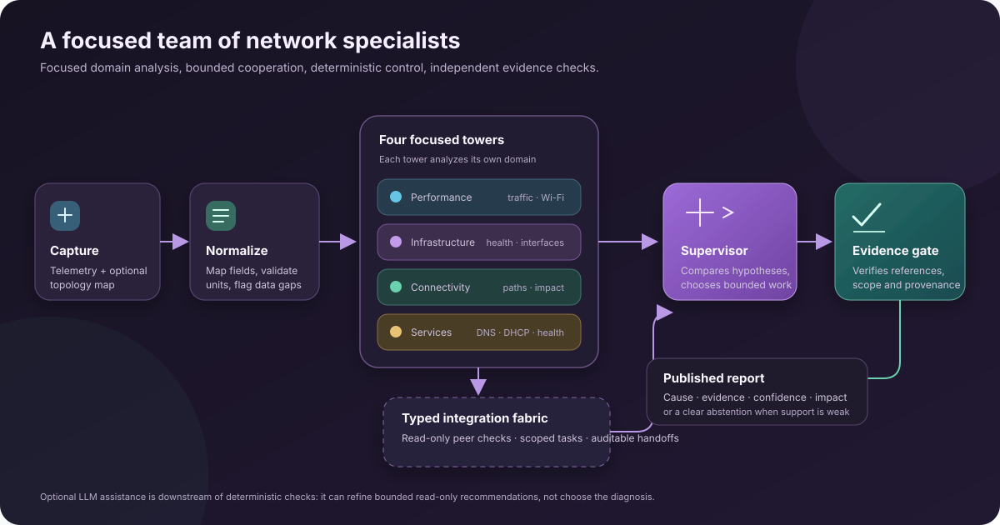
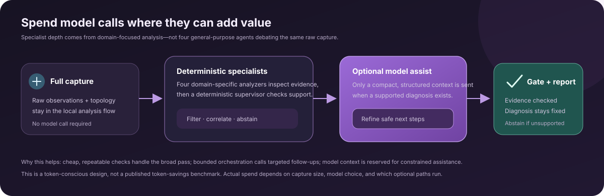

# NetCoop

### Network troubleshooting with specialist agents, bounded teamwork, and evidence you can audit.

NetCoop turns existing network telemetry into a grounded investigation: what the data suggests, which devices may be involved, what supports that conclusion, and what is still unknown.

  
  
  
  

[CLI setup](docs/CLI.md) · [Dashboard setup](docs/DASHBOARD.md) · [Input formats](docs/INPUT_FORMATS.md) · [Network profiles](docs/NETWORK_PROFILES.md)

> **Bring a capture, not a collector.** NetCoop analyzes telemetry files you provide; it does not log in to devices or collect live network data.

## Why NetCoop is different

Many “multi-agent” designs ask several general-purpose models to inspect the same raw data, then hope a debate converges. NetCoop takes a more deliberate route: **four network-domain specialists do focused analysis, a deterministic supervisor controls the investigation, and an independent evidence gate checks the published result.**

That separation is the point. It gives each tower a clear job, lets agents exchange bounded evidence requests, and keeps diagnosis and citations under application control. The optional model path is a constrained assistant to that system—not four extra model calls pretending to be network experts.

  

### Four towers, one shared investigation

| Specialist | What it looks for |
| --- | --- |
| **Performance** | Interface utilization, queue drops, packet loss, retransmissions, jitter, and supported Wi-Fi RSSI/SNR signals. |
| **Infrastructure** | Device resource pressure, interface state and errors, and supported system-log indicators. |
| **Connectivity** | Declared physical paths, partitions when the topology is known to be complete, and possible downstream impact. |
| **Services** | Supported DNS, DHCP, and other service-health signals, including logical dependencies declared in a map. |

Each tower works from the normalized incident evidence and contributes scoped findings. The integration fabric carries typed events, read-only peer checks, and supervisor-assigned tasks between them. For example, a service finding can trigger a connectivity path check; the request, response, status, and supporting topology references stay visible to the supervisor and in the final record.

### Cooperation without an open-ended agent loop

The supervisor owns incident state, task authorization, evidence merging, conflict handling, and publication. It can ask for a targeted follow-up when evidence may distinguish competing hypotheses. The investigation has explicit defaults: at most **4 supervisor calls**, **2 investigation rounds**, **6 specialist tasks**, **2 peer queries per task**, and **1 gate retry**. When the evidence still does not support a conclusion, NetCoop can abstain.

This is useful orchestration: every extra turn has a bounded purpose, and the runtime tracks whether work fits the budget. It avoids relying on free-form debate as a substitute for measurements.

### Token-conscious by design

The towers are domain-specific deterministic analyzers, not four LLM personas. They perform the broad pass locally. The optional OpenRouter path is considered only after the deterministic supervisor has a supported diagnosis; it receives a structured incident dossier and may refine **bounded, read-only recommendations**. It cannot change the root cause, affected entities, confidence, evidence citations, or an abstention.

That means NetCoop does not need to send every capture through a model just to get specialist coverage. It is a **token-conscious architecture**: deterministic analysis first, selective model assistance where it can help. We have not published a measured token-savings benchmark, and actual usage depends on the capture, model, and enabled options.

  

## From capture to an explainable result

1. **Normalize the input.** Read JSON, JSON Lines, or CSV telemetry and an optional JSON topology. Report malformed rows, missing timestamps, unknown metrics, and incompatible units instead of making up values.
2. **Run focused diagnosis.** Performance, infrastructure, connectivity, and services specialists analyze their domains and exchange bounded checks when useful.
3. **Resolve or disclose uncertainty.** The supervisor weighs findings, conflicts, and missing measurements; it can request a limited follow-up or abstain.
4. **Verify before release.** The independent evidence gate checks cited findings, observation provenance, incident scope, data-quality warnings, and orchestration history.
5. **Report impact carefully.** Reports separate entities supported by observations from topology-inferred impact candidates. Inferred means *predicted*, not confirmed user impact.

Use `netcoop triage ... --explain` to stream the actual workflow as it happens: specialist results, inter-agent handoffs, task choices, evidence provenance, and gate checks. Explanation output shows concise rationale summaries, not private model chain-of-thought. JSON reports remain on stdout; the live explanation goes to stderr.

## Built for different networks

NetCoop accepts common local telemetry exports and lets operators adapt supported flat fields through versioned YAML network profiles. A profile can map source field names, entity aliases, known metrics and units, counter semantics, service roles, topology relationships, anchors, completeness, and supported thresholds—without rewriting tower code.

Profiles are a practical adapter layer, not a magic vendor parser. Unknown metrics need analyzer support, and deeply nested collector formats need an explicit adapter. See [Network profiles](docs/NETWORK_PROFILES.md) and [input and topology formats](docs/INPUT_FORMATS.md) for examples and boundaries.

## Choose your workflow

| Want to… | Guide |
| --- | --- |
| Triage a local capture, export JSON/Markdown, or automate a check | [CLI setup and field guide](docs/CLI.md) |
| Start the API and browser dashboard | [Dashboard setup and guide](docs/DASHBOARD.md) |
| Prepare telemetry and a topology map | [Local input formats](docs/INPUT_FORMATS.md) |
| Run a short presentation | [Demo walkthrough](docs/DEMO_SCRIPT.md) |

Both interfaces can use local investigation sessions. A session can hold multiple runs and an assistant conversation; adding telemetry always requires an explicit new analysis run. Chat text is not telemetry and cannot revise a published diagnosis. The optional `--symptom-chat` comparison also runs **after** the evidence gate, so caller wording cannot steer the diagnostic decision.

## Straight talk about the results

- A topology map helps reason about paths and potential blast radius. An absent route only supports a partition claim when the map is explicitly complete.
- `observed` and `inferred` impact are different. Topology-inferred entities are candidates, not proof that users experienced an outage.
- NetCoop performs no live probes. If a distinguishing signal is missing from the capture, the report should identify that gap.
- Included scenarios and generated fixtures are synthetic regression checks, not a real-world accuracy estimate. The provided generator uses a fixed topology and a narrow set of injected faults. See [the benchmark notes](docs/CLI.md#try-the-included-cases).

## Get started

Requirements: Python 3.12 or newer. The dashboard also needs Node.js 18 or newer and npm. Basic deterministic analysis runs locally without an API key; optional model features use OpenRouter.

**Terminal:** follow [CLI setup](docs/CLI.md). **Browser:** follow [dashboard setup](docs/DASHBOARD.md). Setup is intentionally separated so each path stays short and easy to follow.

## Local data and privacy

Run records, reports, sessions, and assistant turns are stored under the local, Git-ignored `data/netcoop/` directory. Deterministic analysis makes no model API calls. When an LLM feature is used, the context needed for that feature is sent to the configured provider; follow your organization's data policy.
