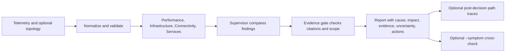

# How NetCoop works

NetCoop is a local, read-only network diagnosis tool. It combines telemetry, optional topology, and specialist analyses into an evidence-backed report. It does not log in to devices, change network configuration, or automatically repair faults.

## Diagnosis flow

### 1. Input and normalization

Telemetry can come from JSON, JSONL, or CSV. A capture directory can also include a `topology.json` map. Network profiles map local field names, entity aliases, units, roles, and known thresholds into NetCoop's supported observation model.

Malformed or incompatible data is reported as a warning or quarantined record. Missing data is not replaced with guessed measurements.

### 2. Specialist analysis

Four deterministic towers look at different evidence:

- **Performance:** link pressure, packet loss, latency, and wireless signal quality.
- **Infrastructure:** CPU, memory, interface errors, and device logs.
- **Connectivity:** recorded paths, partitions, and topology-based impact.
- **Services:** DNS, DHCP, and configuration signals.

Towers share the incident observations and can use bounded, typed queries for targeted checks. Query handlers inspect the observations persisted for this incident and the supplied topology; they do not poll live devices. Their findings preserve source and evidence references. When the supervisor detects a supported conflict, each relevant specialist can receive a structured hypothesis review task that returns supporting, contradicting, inspected, and missing-evidence references.

### 3. Diagnosis and evidence gate

The supervisor compares tower findings, resolves supported conflicts, and proposes a diagnosis or abstains. The independent evidence gate checks that claims have valid incident evidence and scope before the diagnosis is published. Gate checks include stable issue codes; one retry may route actionable issues through the supervisor for a bounded read-only investigation or proposal correction. Repeated tasks are skipped, task and supervisor-call budgets apply, and unresolved gate failures produce an abstention. The gate itself never selects or writes a diagnosis. The default mode is deterministic and offline; an optional configured model can assist supervisor reasoning.

### 4. Supplemental context

After the gate decision, NetCoop may query recorded topology for paths between observed entities and predicted impact candidates. A path means the supplied map contains a route; it does not prove that route caused the reported issue. Partial or unknown topology can make a negative path result inconclusive.

The `--symptom` option invokes a separate context agent after publication. It receives the reported wording, published report, specialist findings, relevant observations, and path results. It can label the wording aligned, mismatched, or unclear, but it cannot revise the diagnosis or send feedback to the supervisor or gate. Without `--symptom`, this agent does not run.

## Reading the impact fields

Reports separate:

- `observed_symptom_entities`: entities tied to cited observation evidence.
- `inferred_affected_entities`: impact candidates inferred from the supplied topology.
- `affected_devices`: compatibility field containing the combined set.

Predicted impact is not confirmation that users experienced an outage. Validate it against operator reports or independent monitoring.

## Outputs and local state

The CLI prints a Rich terminal report by default, or writes JSON and Markdown with `--format json` and `--format markdown`. `--db` stores incident records and reports in SQLite. Without `--db`, the database is temporary and held in memory for the command run.

See the [local input guide](INPUT_FORMATS.md) for file layouts and [network profiles](NETWORK_PROFILES.md) for site adaptation.
