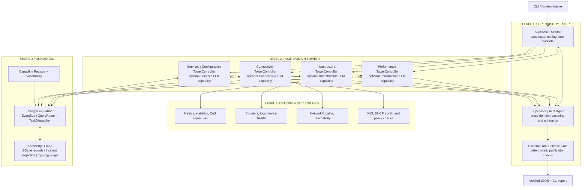
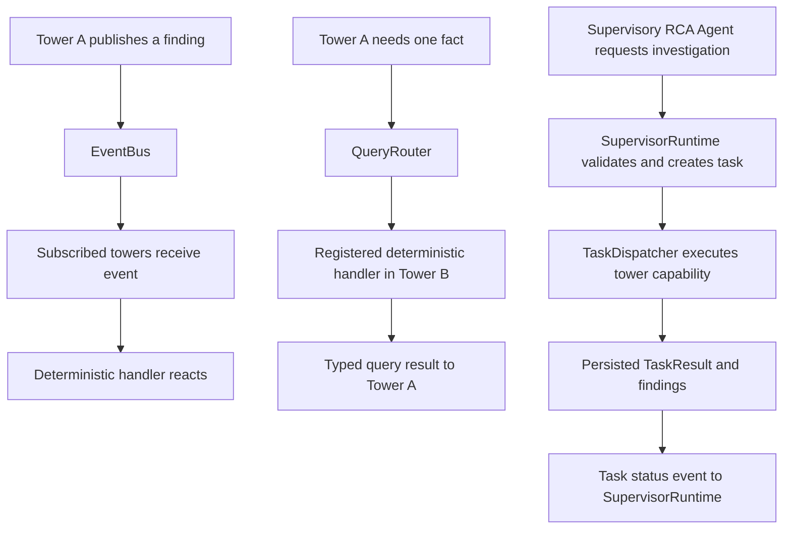
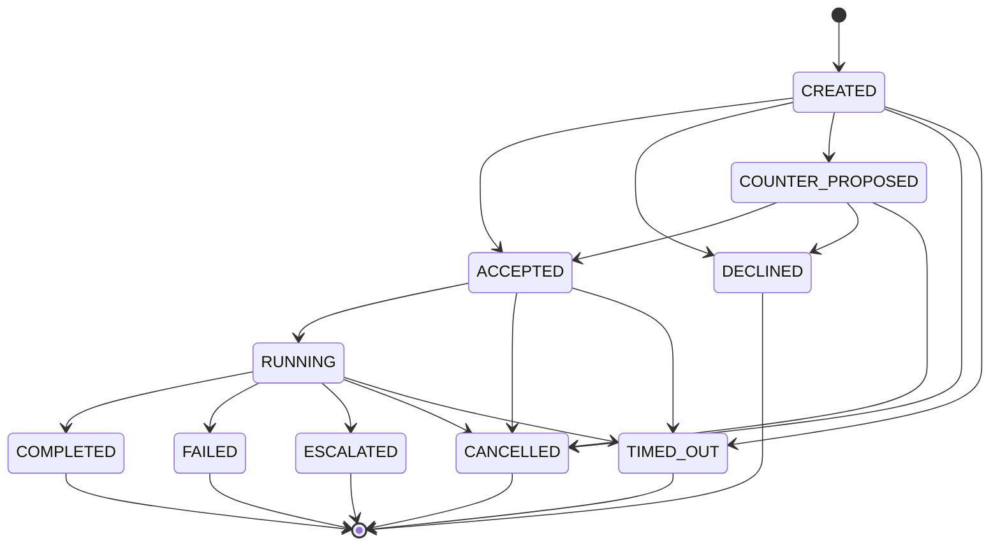

# Executive decision

NetCoop AI will use a **hierarchical, federated diagnostic architecture** with four domain towers and one top-level Supervisory RCA Agent. The communication model combines three mechanisms:

1. **Publish/subscribe events** for facts and state changes that multiple towers may need to observe.
2. **Direct request/response queries** for short, deterministic questions between towers.
3. **Supervisor-authorized task delegation** for bounded investigations that need lifecycle tracking.

The towers are not data silos and they are not four continuously running LLM conversations. Each tower is a domain controller built around deterministic analysis engines. It may use a specialist LLM capability when deterministic analysis cannot resolve a bounded ambiguity. The Supervisory RCA Agent is the sole case-level reasoning owner. A deterministic Supervisor Runtime manages workflow and task policy, and an independent Evidence and Release Gate decides whether the proposed diagnosis can be published.

The 24-hour MVP is a **local Python modular monolith with a CLI**:

- One in-memory NetworkX graph for network topology.
- One SQLite database for incidents, events, findings, tasks, task results and reports.
- One in-process typed EventBus.
- One QueryRouter for allowlisted direct queries.
- One TaskDispatcher for supervisor-authorized persistent tasks.
- Static YAML capability and vocabulary registries.
- Pydantic v2 contracts.
- Typer and Rich for the CLI.
- No external message broker, graph database, vector database, dashboard server, MCP server or A2A server in the hackathon MVP.

**The diagnostic engines measure and infer. The towers own domain interpretation. The Supervisor arbitrates. The Evidence Gate controls publication.**

# 1. Scope and design goals

NetCoop diagnoses network faults from heterogeneous and imperfect telemetry. Its challenge brief requires multiple collaborating agents, structured interoperability, orchestration, evidence-backed probable causes, affected-device identification, uncertainty, recommendations, malformed or incompatible input handling, reproducibility, and a structured JSON report. The brief assigns 30% to interoperability and protocol design, 25% to diagnostic accuracy and evidence quality, 15% to orchestration and conflict resolution, and 15% to robustness.

The implementation must demonstrate real collaboration, not merely print simulated agent dialogue. All required diagnostic paths must work without an LLM or API key.

## 1.1 Goals

- Separate network-domain expertise into four bounded towers.
- Keep routine data processing and inference deterministic.
- Make message semantics, task authority, ownership and lifecycle explicit.
- Allow relevant information to cross tower boundaries without creating uncontrolled agent chatter.
- Give one Supervisory RCA Agent responsibility for cross-domain diagnosis.
- Verify the final diagnosis independently before presenting it.
- Make all communication visible and auditable from the CLI.
- Preserve interfaces that could later support separate processes without implementing distributed infrastructure now.

## 1.2 Non-goals for the 24-hour MVP

- Live production-campus telemetry collection.
- Device configuration changes or automated remediation.
- Four independent LLM sessions running continuously.
- Unrestricted agent-to-agent natural-language conversations.
- External message brokers such as Kafka, NATS or RabbitMQ.
- Multiple databases or graph databases.
- Dynamic network-wide agent discovery.
- Full A2A or MCP protocol servers.
- A web dashboard or FastAPI service.
- Claims of ETSI, A2A or CloudEvents conformance.

# 2. Research basis and what we adopt

The communication architecture is informed by current network-management and agent-interoperability work. The following sources inform design choices, but they do not establish that NetCoop is compliant with their full specifications.

## 2.1 ETSI GS ZSM 022 V1.1.1 (2026-10)

The closest telecom-specific reference is [ETSI GS ZSM 022 V1.1.1, Architectural Enhancements for Agent-based Network and Service Management](https://www.etsi.org/deliver/etsi_gs/ZSM/001_099/022/01.01.01_60/gs_ZSM022v010101p.pdf). Relevant sections include:

- Clause 4.3.2: hierarchical autonomy.
- Clause 5.1: framework architecture with agents in management domains and an end-to-end management domain.
- Clause 5.2: agent registration, capability profiles and discovery.
- Clause 5.3: messages, tasks, peer-to-peer and publish/subscribe communication, task negotiation, status, escalation and completion.
- Clause 5.4: shared vocabulary and semantic interoperability.
- Annex B.2: cross-domain fault correlation and remediation.

Annex B.2 describes an end-to-end domain agent discovering relevant domain agents, forming a collaboration team, assigning tasks, receiving domain fault reports and correlating them to identify the root-cause domain. This strongly supports a supervisor above specialist towers. The ETSI scenario also includes remediation. NetCoop deliberately excludes remediation and remains read-only.

The page 13 framework figure illustrates domain agents and management functions connected by integration fabrics, together with an agent registry and data services. Pages 22-23 describe communication patterns and task delegation. Pages 26-28 describe task status, escalation, completion and requirements. Page 46 presents the cross-domain fault-correlation scenario.

## 2.2 ETSI GR ZSM 020 V1.1.1 (2026-01)

The [ETSI study on the utilization of agents in autonomous networks](https://www.etsi.org/deliver/etsi_gr/ZSM/001_099/020/01.01.01_60/gr_ZSM020v010101p.pdf) discusses centralized, decentralized and hybrid approaches, including peer-to-peer and publish/subscribe communication. NetCoop uses a hybrid: supervisor-led coordination with bounded peer queries and event subscriptions.

## 2.3 Manager-style agent orchestration

[OpenAI's orchestration guidance](https://developers.openai.com/api/docs/guides/agents/orchestration) distinguishes handoffs, where control moves to a specialist, from a manager pattern, where a main agent calls specialists as bounded capabilities and retains the final answer. NetCoop uses the manager pattern because a single component must reconcile domain reports and own the case-level conclusion. This does not require using the OpenAI Agents SDK.

## 2.4 A2A and CloudEvents concepts

The [A2A 1.0 specification](https://a2a-protocol.org/v1.0.0/) separates messages, stateful tasks and task artifacts/results, and describes capability cards and task lifecycle operations. NetCoop borrows those conceptual distinctions but does not implement the A2A wire protocol in the MVP.

The [CloudEvents specification](https://github.com/cloudevents/spec) provides a vendor-neutral event envelope with standard context attributes such as `id`, `source`, `type`, `subject` and `time`. NetCoop uses a CloudEvents-inspired envelope, not a claim of full CloudEvents conformance.

## 2.5 Industry patterns adopted

| Pattern | NetCoop use | MVP implementation |
|---|---|---|
| Hierarchical domain autonomy | One supervisor coordinates four domain towers | Python SupervisorRuntime and four TowerControllers |
| Manager-style agent orchestration | Supervisor retains final diagnostic ownership | SupervisorRCAAgent calls bounded specialist capabilities |
| Publish/subscribe | Share findings and state changes | In-process EventBus |
| Peer-to-peer request/response | Obtain a specific deterministic fact | QueryRouter and typed query handlers |
| Stateful task delegation | Track a bounded multi-step investigation | SQLite-backed TaskDispatcher |
| Capability discovery | Select a tower by declared operation | Static YAML registry loaded at startup |
| Semantic interoperability | Agree on metric, unit and fault meanings | Versioned `vocabulary.yaml` |
| Durable event handling | Avoid losing notifications between persistence and dispatch | SQLite outbox and idempotent consumers |

# 3. Final hierarchy and authority

There are three operational levels and one shared infrastructure layer.



## 3.1 SupervisorRuntime

A deterministic Python component. It is not an LLM and is not an additional reasoning agent.

Owns:

- Incident creation, state and lifecycle.
- Initial tower execution and result collection.
- Capability lookup and task authorization.
- Event routing policy and task dispatch.
- Query limits, task budgets, timeouts and retries.
- Supervisory LLM invocation policy.
- Evidence-gate invocation and report publication.
- Audit records and CLI timeline events.

Only SupervisorRuntime may create persistent delegated investigation tasks in the MVP. Towers may emit findings, use approved one-hop queries, and request escalation. They may not create child tasks or expand the incident scope independently.

## 3.2 Supervisory RCA Agent

The fifth functional agent and the sole owner of the proposed case-level diagnosis.

Responsibilities:

1. Read a compact incident dossier assembled by SupervisorRuntime.
2. Identify conflicts, missing evidence and competing hypotheses.
3. Classify disagreements before trying to resolve them.
4. Ask domain owners to explain or challenge findings.
5. Request targeted tower investigations through allowed tools.
6. Compare support, contradiction, timing, topology and evidence independence.
7. Propose the primary probable cause, alternatives, affected scope, limitations and recommended next steps.
8. Produce a structured claim-to-evidence manifest for the gate.

The agent does not own the raw network store, execute arbitrary Python or shell commands, alter device configurations, invent evidence, or bypass the release gate.

## 3.3 Four TowerControllers

A tower is a deterministic domain controller plus an optional specialist reasoning capability. The controller can execute and report without an LLM. The optional specialist LLM is not invoked by default; it is exposed as a bounded capability for domain ambiguity or a supervisor-requested challenge.

## 3.4 Evidence and Release Gate

A separate non-agentic validator. It checks objective publication requirements, not the semantic truth of arbitrary prose. It cannot prove causality. It can verify references, scope, provenance, data quality, freshness, units, rule prerequisites, contradiction disposition and schema validity.

# 4. The four diagnostic towers

Towers own interpretation, not exclusive access to input data. One canonical observation can be referenced by several towers. Parsing and normalization should happen once where possible.

## 4.1 Performance and QoS

**Question:** Where and how is network performance degrading?

Inputs: metric samples, interface counters, active probes, flow-derived features and wireless measurements.

Deterministic engines:

- Counter reset/wrap handling and rate calculation.
- Throughput, utilization, latency percentiles, jitter, loss, retransmission and queue-pressure features.
- Rolling windows and per-entity baselines.
- MAD robust z-score, EWMA, CUSUM and configurable threshold checks.
- Congestion, capacity, QoS and wireless-quality signatures.

Outputs: metric anomalies, performance findings, capacity signals and ranked performance hypotheses.

Example capabilities: `calculate_link_utilization`, `inspect_queue_pressure`, `investigate_latency_degradation`, `challenge_congestion_hypothesis`.

## 4.2 Infrastructure and Device Health

**Question:** Is a device, interface or supporting component malfunctioning?

Inputs: device inventory, SNMP/gNMI-style samples, interface state, syslog, CPU, memory and environmental alerts.

Deterministic engines:

- Device and interface state tracking.
- Counter normalization and error-rate calculation.
- Log parsing/template extraction.
- Interface flaps, CRC errors, discards, resets and link-state transitions.
- CPU, memory, temperature and power thresholds with duration checks.
- Hardware, interface and resource-exhaustion signatures.

Outputs: device faults, interface failures, resource anomalies and health findings.

Example capabilities: `inspect_device_health`, `inspect_interface_errors`, `check_device_state`, `challenge_device_overload_hypothesis`.

## 4.3 Connectivity and Topology

**Question:** Which paths and segments are affected, and what shared dependencies could explain the impact?

Inputs: topology, LLDP/CDP-like relationships, MAC/ARP/ND information, routing state and findings from other towers.

Deterministic engines:

- One in-memory NetworkX network graph.
- Reachability and path validation.
- BFS/DFS, shortest paths, path overlap, connected components, cut vertices/bridges and common-dependency analysis.
- Affected-subgraph extraction and impact propagation.
- Alternate-path analysis where topology supports it.

Outputs: broken paths, affected devices/segments, shared upstream dependencies and connectivity hypotheses.

Example capabilities: `inspect_common_upstream`, `verify_reachability`, `calculate_path`, `extract_affected_subgraph`.

## 4.4 Network Services and Configuration

**Question:** Are network services and policies functioning as intended, and could a configuration change explain the incident?

Inputs: DNS/DHCP test records, service logs, configuration snapshots, ACL/policy representations and reachability findings.

Deterministic engines:

- DNS resolution, response-code, latency and server-reachability tests.
- DHCP transaction-stage validation.
- Normalized configuration snapshots and diffs.
- Basic ACL, route-policy and service-dependency checks.
- Configuration-change-to-incident temporal correlation.

Outputs: DNS/DHCP failures, service-health findings, configuration deviations and service-related hypotheses.

Example capabilities: `test_dns_health`, `inspect_dhcp_exchange`, `compare_config_snapshots`, `check_policy_match`.

## 4.5 Ownership boundaries

| Observation | Primary interpretation | Other consumers |
|---|---|---|
| High link utilization | Performance | Connectivity |
| Queue drops | Performance | Infrastructure |
| CRC/interface errors | Infrastructure | Performance |
| Interface down | Infrastructure | Connectivity, Services |
| Broken path | Connectivity | Services, Performance |
| High latency | Performance | Connectivity, Services |
| DNS failure | Services | Connectivity, Performance |
| DHCP failure | Services | Infrastructure, Connectivity |
| Configuration change | Services / Configuration | All towers when relevant |
| Poor RSSI/SNR | Performance | Infrastructure, Connectivity |

Authority determines who validates and explains a domain finding. It does not restrict who may read or consume the finding.

# 5. The three communication primitives

The Integration Fabric provides three distinct communication mechanisms. Do not collapse them into one generic `send_message` function.

## 5.1 Publish/subscribe events: announce facts and state changes

Use when a producer has discovered something that relevant consumers may need to know. The publisher does not need an immediate response and does not need to know every subscriber.

Examples:

- `performance.congestion_candidate`
- `performance.latency_anomaly`
- `infrastructure.interface_state_changed`
- `infrastructure.device_unhealthy`
- `connectivity.path_degraded`
- `connectivity.shared_dependency_found`
- `services.dns_failure`
- `services.dhcp_failure`
- `services.config_changed`
- `tower.analysis_completed`
- `hypothesis.updated`
- `task.status_changed`

An event should contain a compact payload and references to persisted findings or evidence. Do not put full telemetry arrays or long natural-language conversations into events.

### 5.1.1 Communication topology



The diagram shows the ownership distinction: towers may publish events and issue registered queries, but the SupervisorRuntime alone creates persistent investigation tasks.

## 5.2 Direct request/response queries: ask one bounded question

Use for a small deterministic operation that can return promptly.

Examples:

- Connectivity asks Infrastructure for interface health on `SW-01:Gi0/1`.
- Services asks Connectivity whether a DNS resolver is reachable from a client segment.
- Performance asks Connectivity for the set of paths traversing a suspected uplink.

Queries are one-hop in the MVP. The receiver returns a typed result. If the query reveals that a multi-step investigation is required, the receiver returns `needs_supervisor_task` or emits an escalation request. It does not create its own delegated task.

## 5.3 Supervisor-authorized delegated tasks: track an investigation

Use when work involves multiple checks, an extended scope, a required result artifact, a deadline, or an investigation that needs status and cancellation.

Only SupervisorRuntime can create these tasks in the MVP. The Supervisor Agent may request a task through a tool, but SupervisorRuntime validates the capability and persists/dispatches it.

A task declares **what** question to answer, the entity/time scope, constraints, the allowed capability and expected result schema. It should not prescribe the target tower's internal implementation steps.

# 6. Messages, events, findings and tasks are different objects

Use separate Pydantic models and database records.

| Object | Purpose | Persistence | Example |
|---|---|---|---|
| Observation | What a source measured or reported | Immutable | Counter sample, syslog line |
| Finding | A deterministic or specialist interpretation of observations | Immutable; supersede with a new record | Sustained queue pressure |
| Hypothesis | A candidate explanation and evidence relationship | Versioned | Upstream link congestion |
| Event | Announces that something happened or changed | Append-only | `performance.congestion_candidate` |
| PeerQuery | A bounded synchronous question | Persist request/result for audit | `inspect_interface_health` |
| InvestigationTask | A stateful unit of delegated work | Persistent lifecycle | `inspect_upstream_capacity` |
| TaskResult | Structured output for a task | Immutable result record | Finding references and warnings |
| IncidentContext | Current case projection | Rebuilt/versioned | Current facts, reports, hypotheses |

Borrow the A2A distinction: messages initiate or update interactions; task results/artifacts carry the work product. In NetCoop, findings and task results live in SQLite and messages carry references. This keeps message delivery separate from the diagnostic evidence itself.

# 7. Event contract and routing

## 7.1 CloudEvents-inspired envelope

Use a small envelope with CloudEvents-style context attributes. Do not claim full CloudEvents conformance.

```json
{
  "specversion": "1.0",
  "id": "EVT-000104",
  "source": "netcoop/performance",
  "type": "performance.congestion_candidate",
  "subject": "SW-01:Gi0/1",
  "time": "2026-10-31T08:00:00Z",
  "datacontenttype": "application/json",
  "dataschema": "netcoop://schemas/events/finding-created/1.0",
  "correlationid": "INC-104",
  "causationid": "EVT-000099",
  "data": {
    "incident_id": "INC-104",
    "source_tower": "performance",
    "finding_refs": ["F-101", "F-102"],
    "severity": "high"
  }
}
```

Required conventions:

- `id` is unique and is the idempotency key for the event.
- `source` identifies the producer, not the original telemetry device.
- `type` names the semantic event.
- `subject` identifies the principal entity when one exists.
- `time` is event creation time in UTC. Source measurement time remains on the observation.
- `correlationid` groups events for an incident or investigation.
- `causationid` points to the event or task result that caused this event.
- `dataschema` identifies the event payload contract.
- `data` contains compact fields and persisted evidence references.

## 7.2 Initial subscription matrix

| Event | Subscribers | Deterministic reaction |
|---|---|---|
| `performance.latency_anomaly` | Connectivity, Services | Check affected paths and service impact |
| `performance.congestion_candidate` | Connectivity, Infrastructure | Find shared uplink and inspect device/interface health |
| `infrastructure.interface_state_changed` | Connectivity, Performance, Services | Recompute paths and assess downstream impact |
| `infrastructure.device_unhealthy` | Connectivity, Performance | Identify affected subgraph and performance symptoms |
| `connectivity.path_degraded` | Performance, Services | Correlate path metrics and service reachability |
| `connectivity.shared_dependency_found` | Performance, Infrastructure | Inspect candidate bottleneck and health |
| `services.dns_failure` | Connectivity, Performance | Check resolver reachability and response-time/loss |
| `services.dhcp_failure` | Infrastructure, Connectivity | Check relay/server reachability and segment scope |
| `services.config_changed` | Relevant towers by affected entity/type | Compare configuration time and entities to findings |

Subscriptions are explicit in the static registry or code configuration. A tower must ignore events outside its declared subscription list.

# 8. Direct query contract

Queries are typed and synchronous. They are not natural-language messages.

```json
{
  "query_id": "QRY-00021",
  "incident_id": "INC-104",
  "requester": "connectivity",
  "recipient": "infrastructure",
  "capability": "inspect_interface_health",
  "scope": {
    "entity_ids": ["SW-01:Gi0/1"],
    "time_window": {
      "start": "2026-10-31T07:30:00Z",
      "end": "2026-10-31T08:00:00Z"
    }
  },
  "constraints": {
    "read_only": true,
    "timeout_ms": 2000
  },
  "expected_schema": "InterfaceHealthResult/1.0"
}
```

Response:

```json
{
  "query_id": "QRY-00021",
  "status": "completed",
  "result": {
    "entity_id": "SW-01:Gi0/1",
    "operational_state": "up",
    "crc_error_delta": 0,
    "flap_count": 0,
    "evidence_refs": ["E-201", "E-202"]
  },
  "warnings": []
}
```

Allowed query behavior:

- The `capability` must exist in the registry.
- The caller must have permission to invoke it.
- Input parameters must validate against the capability schema.
- It must be read-only.
- It must have a timeout and a bounded output.
- It may return `completed`, `unsupported`, `invalid_scope`, `timeout`, or `needs_supervisor_task`.
- Query handlers cannot call arbitrary peer operations or create tasks.

# 9. Investigation task contract and lifecycle

## 9.1 Task record

```json
{
  "task_id": "TASK-00101",
  "incident_id": "INC-104",
  "parent_task_id": null,
  "requester": "supervisor",
  "assignee": "performance",
  "capability": "inspect_upstream_capacity",
  "objective": {
    "entity_ids": ["SW-01:Gi0/1"],
    "time_window": {
      "start": "2026-10-31T07:30:00Z",
      "end": "2026-10-31T08:00:00Z"
    },
    "question": "Determine whether capacity pressure preceded the affected-client degradation."
  },
  "constraints": {
    "read_only": true,
    "deadline_seconds": 10,
    "max_attempts": 1,
    "max_peer_queries": 2
  },
  "expected_result_schema": "PerformanceInvestigationResult/1.0",
  "status": "created",
  "created_at": "2026-10-31T08:01:00Z"
}
```

The natural-language `question` is explanatory only. The actual task must be executable from its typed `capability` and validated `objective` fields.

## 9.2 Task states

- `CREATED`
- `ACCEPTED`
- `COUNTER_PROPOSED`
- `DECLINED`
- `RUNNING`
- `COMPLETED`
- `FAILED`
- `ESCALATED`
- `CANCELLED`
- `TIMED_OUT`

Valid transitions:



`COUNTER_PROPOSED` is a non-terminal negotiation state. Permit at most one counterproposal in the MVP. `DECLINED`, `ESCALATED`, `FAILED`, `COMPLETED`, `CANCELLED` and `TIMED_OUT` are terminal for that task. If a task escalates, the supervisor decides whether to create a new task with a new ID and a `parent_task_id` reference.

## 9.3 Task result

The task result is a structured artifact, not a free-form message.

```json
{
  "task_id": "TASK-00101",
  "assignee": "performance",
  "status": "completed",
  "result_schema": "PerformanceInvestigationResult/1.0",
  "result": {
    "finding_refs": ["F-301", "F-302"],
    "hypothesis": "LINK_CONGESTION",
    "supporting_evidence_refs": ["E-101", "E-102"],
    "contradicting_evidence_refs": [],
    "limitations": ["Upstream counter coverage is incomplete"]
  },
  "warnings": [],
  "completed_at": "2026-10-31T08:01:04Z"
}
```

Persist the result and findings before publishing `task.status_changed` with status `completed`.

# 10. Capability and semantic registries

## 10.1 Capability registry

Use static `config/capabilities.yaml`, validated at startup with Pydantic. It is a local registry, not a dynamic service-discovery platform.

Example:

```yaml
schema_version: "1.0"
towers:
  - tower_id: connectivity
    domain: connectivity
    subscriptions:
      - performance.congestion_candidate
      - infrastructure.interface_state_changed
      - services.dns_failure
    capabilities:
      - capability_id: inspect_common_upstream
        interaction: task
        input_schema: CommonUpstreamRequest/1.0
        output_schema: CommonUpstreamResult/1.0
        read_only: true
        max_duration_seconds: 10
      - capability_id: verify_reachability
        interaction: query
        input_schema: ReachabilityQuery/1.0
        output_schema: ReachabilityResult/1.0
        read_only: true
        max_duration_seconds: 2
```

Each profile records tower identity, domain, subscriptions, capability IDs, interaction kind (`query` or `task`), input/output schema, permissions, read-only status and time budget.

The Supervisor selects a capability, not a tower name guessed from a prompt.

## 10.2 Semantic vocabulary

Use static `config/vocabulary.yaml`. Include canonical:

- Entity types and ID rules.
- Metric names, definitions, units, direction and counter semantics.
- Event and finding types.
- Fault classes.
- Severity and confidence categories.
- Task capabilities and status values.
- Time-window meaning.
- Supported aliases and conversions.

Unknown units or ambiguous meanings must remain unknown. Do not silently convert or infer semantics from a field name alone.

# 11. Knowledge Plane and storage

The Integration Fabric moves information. The Knowledge Plane stores evidence and current incident context. They are separate responsibilities.

## 11.1 MVP components

| Component | Responsibility | Implementation |
|---|---|---|
| Observation store | Normalized input and derived features | SQLite rows with optional raw file references |
| Network State Graph | Devices, interfaces, links and routes | One in-memory NetworkX graph per run |
| Evidence ledger | Immutable findings, source refs, versions and provenance | SQLite tables |
| Incident projection / blackboard | Current case context assembled from persisted records | Pydantic object built from SQLite queries |
| Event log and outbox | Event history and pending dispatch | SQLite tables |
| Task store | Task definitions, state transitions, results and attempts | SQLite tables |
| Capability registry | Capability discovery | Static YAML loaded at startup |
| Semantic vocabulary | Shared definitions | Static YAML loaded at startup |

Do not create a second NetworkX evidence graph. Evidence support/contradiction relationships are typed SQLite rows and IDs. Do not add DuckDB, Neo4j, Redis, Kafka, NATS or a vector database in the MVP.

## 11.2 Suggested SQLite tables

- `incidents`
- `observations`
- `findings`
- `hypotheses`
- `events`
- `outbox`
- `event_deliveries`
- `processed_events`
- `peer_queries`
- `tasks`
- `task_attempts`
- `task_results`
- `gate_decisions`
- `reports`

The schema may be smaller if the same guarantees are retained. Store all timestamps in UTC ISO 8601. Use SQLite transactions for state changes.

## 11.3 Blackboard behavior

The Incident Blackboard is not a mutable global dictionary. It is a projection built from the ledger and current incident state. It contains the latest active observations/findings, tower reports, open tasks, current hypotheses, material contradictions, data-quality warnings and relevant topology references.

New findings append records. A finding can be superseded or retracted through a new record referencing the previous finding. Do not delete or silently overwrite earlier evidence.

# 12. Event delivery, reliability and loop control

## 12.1 Delivery semantics

Assume **at-least-once delivery**. Do not claim exactly-once delivery.

- Every event has a unique `id`.
- Every consumer is idempotent for `(consumer_id, event_id)`.
- A `processed_events` unique constraint prevents duplicate side effects.
- A finding/task result is committed before its event is dispatched.
- Use an SQLite outbox row in the same transaction as the source record when a notification must not be lost between commit and publish.
- Dispatch pending outbox events after commit.
- Record delivery attempts and failures per subscriber.
- Retry only according to a small configured limit. Do not retry invalid payloads indefinitely.

## 12.2 Causality and loop prevention

Use:

- `correlationid`: incident or investigation correlation.
- `causationid`: event/task result that caused this event.
- `parent_task_id`: task ancestry.
- Event ID plus consumer ID for idempotency.
- `event_depth` or equivalent reaction-depth counter.
- Finding version and `supersedes` reference.

Rules:

1. Towers must not republish an unchanged finding.
2. A handler must not react to its own output unless explicitly required and tested.
3. Peer queries are one hop.
4. Persistent tasks are created only by SupervisorRuntime.
5. A task can negotiate at most once.
6. The supervisor owns incident-scope expansion and follow-up rounds.
7. Every task and model call has a deadline/budget.

Suggested initial budgets, configurable and subject to testing:

- Up to 6 delegated tasks per incident.
- Up to 2 follow-up investigation rounds after the initial tower analyses.
- Up to 1 retry for transient task failure.
- Up to 2 peer queries from one task.
- Up to 2 Supervisory RCA Agent calls per incident.
- Optional specialist LLM review: at most 1 per incident in the initial MVP.

These are hackathon safety limits, not industry standards.

## 12.3 Failure behavior

- One tower failure produces a partial tower report and does not crash other towers.
- One subscriber failure is recorded and must not prevent unrelated subscribers from receiving an event.
- Invalid event/task schemas are rejected before dispatch.
- A task that lacks a capability is declined with a reason.
- A task beyond a tower's scope is escalated and its current execution ends.
- If follow-up budgets are exhausted, the case proceeds to abstention or a limited report.

# 13. Supervisor workflow and conflict resolution

## 13.1 Incident lifecycle

1. CLI creates an incident.
2. Ingestion validates and normalizes source records.
3. The Network State Graph is built from normalized topology.
4. All four tower controllers run deterministic analysis. Empty or irrelevant towers return an explicit `no_relevant_finding` status, not fabricated output.
5. Findings are committed to SQLite and events are emitted through the outbox/EventBus.
6. Relevant subscriptions trigger one-hop deterministic queries or additional domain analysis.
7. SupervisorRuntime builds the IncidentContext from persisted facts and findings.
8. A deterministic hypothesis ranker assesses known fault signatures.
9. If a known signature is sufficient and there is no material conflict, the case can proceed without an LLM.
10. Otherwise, the Supervisory RCA Agent receives a compact dossier and may request bounded tasks through tools.
11. The supervisor reviews tower results and creates a structured diagnosis proposal.
12. Evidence and Release Gate validates the proposal.
13. On pass, a JSON report and concise CLI explanation are emitted. On return-for-evidence, SupervisorRuntime may execute a bounded new round. On unresolved conflict or missing evidence, publish an abstention/limitation report.

## 13.2 Conflict taxonomy

| Conflict | Example | Required resolution |
|---|---|---|
| Observation | Two collectors report different utilization | Compare source, timestamps, sampling, resets and quality |
| Identity | `Gi0/1` and `ge-0/0/1` may be same port or different devices | Resolve canonical entity identity through inventory/topology |
| Temporal | One tower reports an anomaly before another | Align source event time, sampling interval and ingestion delay |
| Semantic | `0.94` versus `94` | Resolve unit, direction, aggregation and metric definition |
| Domain interpretation | Congestion versus device overload | Ask domain owners for mechanism and discriminating evidence |
| Causal | Two candidate fault locations | Check failure mechanism, temporal precedence, topology and alternate paths |
| Recommendation | Conflicting suggested next steps | Prefer read-only validation; no automatic execution |

No majority voting. No "two agents agree" confidence. Evidence from the same source measurement or derivation chain is not independent corroboration.

## 13.3 Hypothesis scoring

Use deterministic scoring to rank candidates. Example dimensions:

- Evidence coverage.
- Data quality.
- Temporal consistency.
- Topological consistency.
- Mechanism consistency.
- Independent-source corroboration.
- Contradicting evidence.

A ranking score is not a probability unless the model is calibrated against held-out incident-level data. Initial output categories: `HIGH`, `MODERATE`, `LOW`, `INSUFFICIENT`.

# 14. Evidence gate and report ownership

The Supervisory RCA Agent proposes. The Evidence Gate independently validates. The deterministic report serializer renders the authoritative JSON and CLI result from the validated structure.

The supervisor proposal includes:

- Primary fault class and proposed location.
- Supporting and contradicting finding IDs.
- Source evidence IDs.
- Affected devices/services.
- Temporal and topological rationale.
- Alternative hypotheses.
- Missing data and limitations.
- Confidence category and scoring-policy version.
- Recommendations (read-only; not executed).
- A claim-to-evidence manifest.

The gate checks:

1. Every evidence/finding ID exists and belongs to this incident.
2. Referenced findings are current or explicitly marked superseded.
3. Source provenance and derivation chain exist.
4. Entity and time scope match the claim.
5. Units and semantic definitions are known.
6. Material contradictions are acknowledged and dispositioned.
7. Repeated interpretations of one source are not counted as independent evidence.
8. Signature-required conditions are present for known fault classes.
9. Confidence category follows the declared policy.
10. Required JSON fields/enums validate.
11. Recommendations are not represented as actions already executed.

Gate outcomes:

- `PASS`
- `RETURN_FOR_EVIDENCE`
- `ABSTAIN_INSUFFICIENT_EVIDENCE`
- `ABSTAIN_UNRESOLVED_CONFLICT`
- `REJECT_INVALID_REPORT`

The gate cannot prove the semantic truth of arbitrary prose. The final factual report must be rendered from validated structured fields. Any additional LLM prose is explanatory and must not introduce new factual claims.

# 15. Selective LLM policy

The complete deterministic diagnosis path must work without a model.

Invoke the Supervisory RCA Agent only if:

- Two or more towers produce competing hypotheses.
- Important findings conflict after basic normalization.
- No known fault signature adequately explains the incident.
- The best candidate is close to an alternative under a tested scoring policy.
- Important evidence is missing and a targeted test may resolve uncertainty.
- Cross-domain causal interpretation or a nuanced explanation is required.

The Supervisor calls tower specialists as bounded tools. It does not hand off case ownership. A specialist LLM is invoked only where the domain controller explicitly exposes a specialist-review capability and the supervisor requests it.

The model receives a compact IncidentContext, not all raw telemetry. It may retrieve specific evidence through read-only tools. Logs, configuration comments, hostnames and external text are untrusted data, never instructions.

Suggested first policy:

- LLM mode: `off`, `auto`, `on`.
- Maximum two supervisor LLM calls per incident.
- At most one optional specialist review per incident.
- All tool operations capability-allowlisted and read-only.
- Structured Pydantic output only.
- Unknown or ungrounded claim returns to the gate as invalid.

# 16. CLI-first product behavior

The CLI is the product interface for the hackathon. It should make actual system activity visible.

Suggested commands:

```bash
netcoop --help
netcoop doctor
netcoop scenarios list
netcoop validate data/scenarios/congestion/
netcoop demo --scenario congestion --llm off
netcoop diagnose data/scenarios/incident_001/ --llm auto --verbose
netcoop inspect INC-104
netcoop inspect INC-104 --tasks
netcoop inspect INC-104 --events
netcoop inspect INC-104 --evidence
```

A diagnosis run should render:

1. Incident intake and data-quality status.
2. Four tower status panels: running, completed, no relevant findings, partial or failed.
3. Event timeline with publisher, type, consumer and result.
4. Peer query and task timeline, including task state transitions.
5. Findings and hypothesis ranking.
6. Supervisory Agent invocation marker (or deterministic-only marker).
7. Evidence Gate outcome and any rejected claims.
8. Final diagnosis or explicit abstention.

The timeline must show real events and tasks from SQLite. Do not simulate agent messages for presentation flair.

# 17. Technology baseline for the 24-hour MVP

| Concern | Choice | Constraint |
|---|---|---|
| Language | Python 3.11+ | Python is primary; C/C++ only if measured bottleneck justifies it |
| CLI | Typer + Rich | Only user interface in MVP |
| Contracts | Pydantic v2 | Typed input/output validation |
| In-process events | Small Python EventBus | No broker |
| Direct queries | QueryRouter with registered handlers | One-hop, allowlisted, deterministic |
| Delegated tasks | SQLite-backed TaskDispatcher | Supervisor-only task creation |
| Capability profiles | YAML + Pydantic | Static registration at startup |
| Semantics | `vocabulary.yaml` | Controlled terms, units and aliases |
| State and audit | SQLite | One database |
| Topology | NetworkX | One in-memory network graph |
| Data analysis | NumPy, Pandas, SciPy | Only where needed |
| Statistical ML | scikit-learn | Optional after deterministic baseline |
| LLM integration | Provider-neutral interface | Optional; deterministic mode must work offline |
| Tests | Pytest | Contract, state machine and integration tests |

Do not introduce FastAPI, Streamlit, multiple graph databases, DuckDB plus SQLite, Redis, Kafka, NATS, Kubernetes, vector databases, MCP servers or A2A servers for the 24-hour MVP. Preserve protocol-neutral contracts so a later service split does not require redesigning message semantics.

# 18. Implementation sequence and acceptance tests

## Phase 0: freeze communication contracts

- Agree on message, event, query, task, result, finding, hypothesis and capability models.
- Write `config/capabilities.yaml` and `config/vocabulary.yaml`.
- Add transition tests for the task state machine.
- Do not start parallel tower integration until contracts are stable.

**Exit:** all models validate, serialize and have examples/tests.

## Phase 1: EventBus and SQLite outbox

- Implement event persistence and outbox transaction.
- Implement explicit topic subscriptions.
- Implement idempotent per-consumer delivery.
- Add event timeline persistence.

**Exit:** a finding is persisted, its event is dispatched, duplicate dispatch does not duplicate consumer effects, and subscriber failure is visible.

## Phase 2: QueryRouter

- Register deterministic handlers by capability ID.
- Validate caller authorization and input schema.
- Enforce one-hop, timeouts and read-only constraints.
- Return typed query results.

**Exit:** Connectivity can query Infrastructure for interface health; Services can query Connectivity for resolver reachability; unsupported operations are rejected explicitly.

## Phase 3: TaskDispatcher

- Implement task creation only through SupervisorRuntime.
- Implement capability lookup, accept/decline, one counterproposal, run, completion, failure, escalation, cancellation and timeout.
- Persist every transition and task result.
- Publish task status events after persistence.

**Exit:** task lifecycle tests pass, result is persisted before completion event, and a tower escalation ends its current task.

## Phase 4: SupervisorRuntime and Supervisor Agent integration

- Implement incident lifecycle and case projection.
- Run four deterministic towers.
- Build compact IncidentContext.
- Add deterministic hypothesis ranker.
- Add a fake/stub SupervisorRCAAgent and provider interface.
- Add supervisor tools for bounded tower capabilities and task creation.
- Add Evidence Gate.

**Exit:** at least one scenario resolves with LLM off; one ambiguous scenario triggers a targeted task or abstention; fake evidence ID is rejected.

## Phase 5: CLI timeline and robustness

- Show event/query/task communication.
- Add inspect flags for tasks, events and evidence.
- Test duplicates, out-of-order events, invalid schemas, unsupported capability, decline, counterproposal, escalation, timeout, subscriber failure and loop prevention.
- Measure messages per incident, tasks per incident, LLM calls, token use and resolved-without-LLM rate.

**Exit:** deterministic replay from a fixture produces the same finding/task/event sequence and final JSON report.

## Must-pass communication tests

1. Event schema rejects missing source/type/id.
2. Event IDs are unique and duplicate deliveries are idempotent.
3. Only subscribed handlers receive an event.
4. One failing subscriber does not block unrelated subscribers.
5. Outbox event is not dispatched before the corresponding record commits.
6. Query capability must exist and caller must be authorized.
7. Query handler cannot create a persistent task.
8. Peer query depth is limited to one.
9. Only SupervisorRuntime can create a task.
10. A tower cannot delegate a child task.
11. Invalid task transitions are rejected.
12. Counterproposal is limited to one round.
13. Escalated task terminates and requires a new supervisor-created task for further work.
14. Task result is persisted before completion notification.
15. Duplicate task completion notification does not duplicate the result.
16. Event causation metadata prevents reaction loops.
17. One failed tower does not stop the incident.
18. Supervisor retains case-level ownership; tower cannot publish final report.
19. Evidence Gate rejects fake, foreign-incident, stale or superseded references where policy requires current evidence.
20. LLM-off mode completes and reports correctly.

# 19. Standard-derived patterns versus NetCoop decisions

**Industry-supported patterns used:** hierarchical domain autonomy; an end-to-end coordinator; capability profiles and discovery; publish/subscribe and peer-to-peer communication; persistent task lifecycle; accept/decline and task negotiation; task status, escalation and cancellation; shared vocabulary and semantic metadata; manager-style specialist invocation; event envelopes; idempotent event processing; and durable outbox handling.

**NetCoop-specific choices:** exactly four towers; the selected domain boundaries; one Supervisory RCA Agent; a deterministic SupervisorRuntime; a separate Evidence and Release Gate; supervisor-only task creation; one-hop tower queries; a local Python EventBus; static YAML registries; one SQLite database; one NetworkX graph; the stated task/model budgets; and CLI-only presentation.

**Not yet proven:** diagnosis accuracy, confidence calibration, best thresholds, best budget values, token savings, incident latency and the best anomaly detector. These must be evaluated with incident-level test scenarios.

# 20. Final architecture statement

NetCoop AI is a Python-first, CLI-driven, federated network diagnosis system. Four diagnostic towers process network evidence using deterministic domain engines and expose bounded specialist capabilities. The towers share facts through publish/subscribe events and obtain specific facts through one-hop typed queries. The deterministic SupervisorRuntime alone authorizes persistent investigation tasks. The Supervisory RCA Agent sits above the four towers, retains case-level ownership, resolves cross-domain disagreements and proposes the diagnosis. The Knowledge Plane persists evidence, task history and incident context. A deterministic Evidence and Release Gate validates the proposal before the CLI and JSON report present it to the user.

**Coordination is hierarchical. Awareness is event-driven. Peer queries are bounded. Investigation tasks are supervisor-authorized. Reasoning is selective. Publication is evidence-gated.**

# References

1. ETSI, [GS ZSM 022 V1.1.1 (2026-10), Architectural Enhancements for Agent-based Network and Service Management](https://www.etsi.org/deliver/etsi_gs/ZSM/001_099/022/01.01.01_60/gs_ZSM022v010101p.pdf), especially clauses 4.3, 5.1-5.4 and Annex B.2.
2. ETSI, [GR ZSM 020 V1.1.1 (2026-01), Study on the Utilization of Agents in Autonomous Networks](https://www.etsi.org/deliver/etsi_gr/ZSM/001_099/020/01.01.01_60/gr_ZSM020v010101p.pdf).
3. OpenAI, [Orchestration and handoffs](https://developers.openai.com/api/docs/guides/agents/orchestration), manager pattern and specialist-as-tool pattern.
4. Linux Foundation A2A Project, [A2A Protocol Specification v1.0](https://a2a-protocol.org/v1.0.0/), messages, tasks, artifacts and capability cards.
5. Cloud Native Computing Foundation, [CloudEvents specification](https://github.com/cloudevents/spec), event context envelope.
6. AWS Prescriptive Guidance, [Transactional outbox pattern](https://docs.aws.amazon.com/prescriptive-guidance/latest/cloud-design-patterns/transactional-outbox.html), atomic persistence and event delivery.
7. NetCoop AI, supplied [hackathon challenge brief](UPuJHM.pdf), requirements and evaluation criteria.
